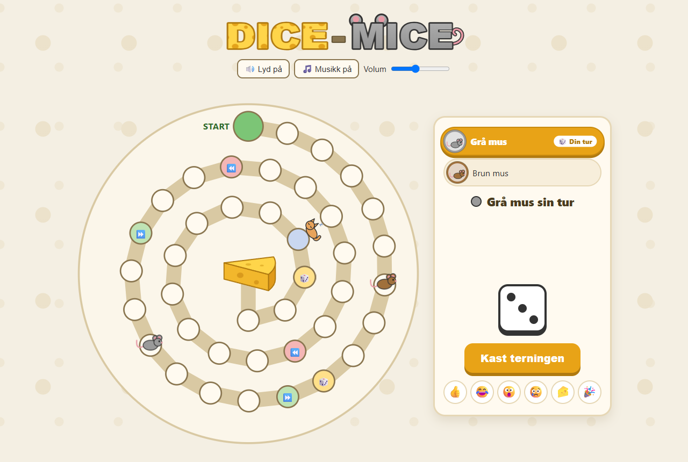

<p align="center">
  
</p>

**Dice-Mice!** er et brettspill i nettleseren der musene kaster terning og løper i en spiral inn mot osten i midten – den som kommer først til osten, vinner.

### ▶ [Spill her: kevhan05.github.io/Dice-Mice](https://kevhan05.github.io/Dice-Mice/)



## Slik spiller du

1. Velg antall spillere (1–4) og brett (kort, vanlig eller lang), skriv inn navn og velg pynt på musen din.
2. Trykk **Kast terningen** når det er din tur. Musen hopper like mange felt som terningen viser.
3. Slår du **6**, får du kaste igjen.
4. Noen felt gjør noe når du lander på dem:

   | Felt | Hva skjer |
   |---|---|
   | ⏩ Ostesmuler (grønn) | Hopp 3 felt frem |
   | ⏪ Musefelle (rød) | Gå 3 felt tilbake |
   | 🎲 Kast igjen (gul) | Du får et ekstra kast |
   | Kattefeltet (blått, med en sovende katt ved siden av) | Katten våkner og blir sur 😾 – du står over neste runde |

5. Den som først kommer til osten i midten, vinner. Du trenger ikke treffe osten nøyaktig.
6. Etter spillet står musene på en **pall** etter hvor langt de kom. Er dere fire, står den siste ved siden av og gråter. Velg **Spill igjen** eller **Tilbake til lobby**.

Alle spiller på samme maskin, og spillet fungerer på både PC og telefon.

## Kjøre spillet lokalt

Spillet er bare vanlig HTML, CSS og JavaScript, så du trenger ikke installere noe:

1. Last ned eller klon repoet:
   ```bash
   git clone https://github.com/kevHan05/Dice-Mice.git
   ```
2. Åpne `index.html` i nettleseren.

## Om prosjektet

Dice-Mice! er laget for å lære GitHub – issues, brancher, pull requests og merging – sammen med [Claude Code](https://claude.com/claude-code). Hver endring starter som et issue, lages på en egen branch, testes automatisk i en ekte nettleser med Playwright og samles i `test` før den går til `main`.
